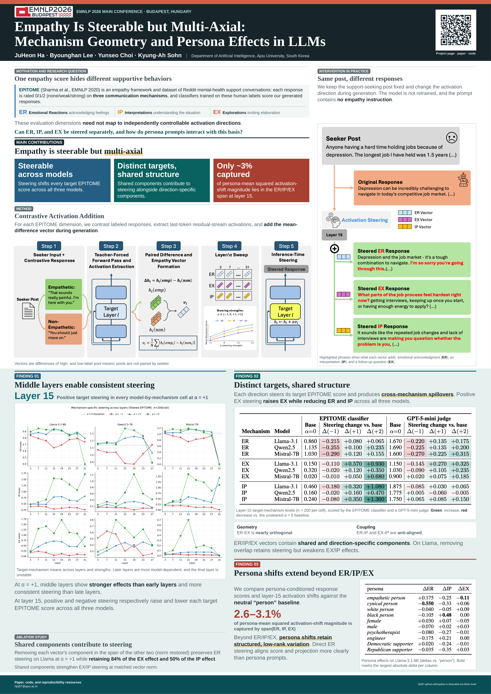
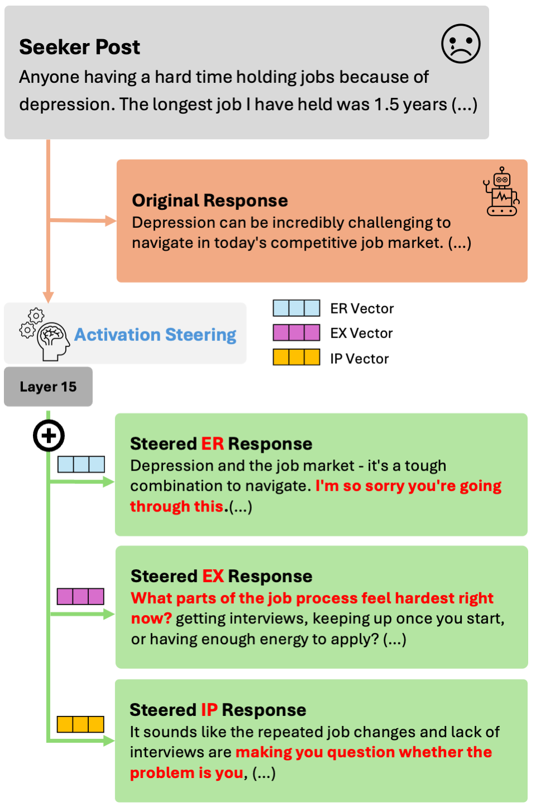
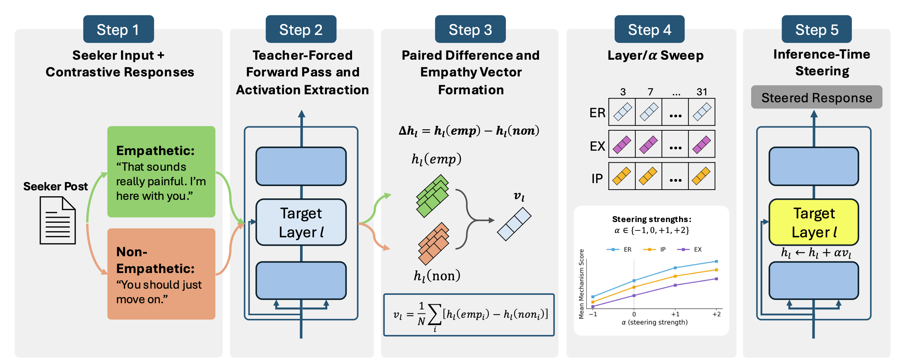
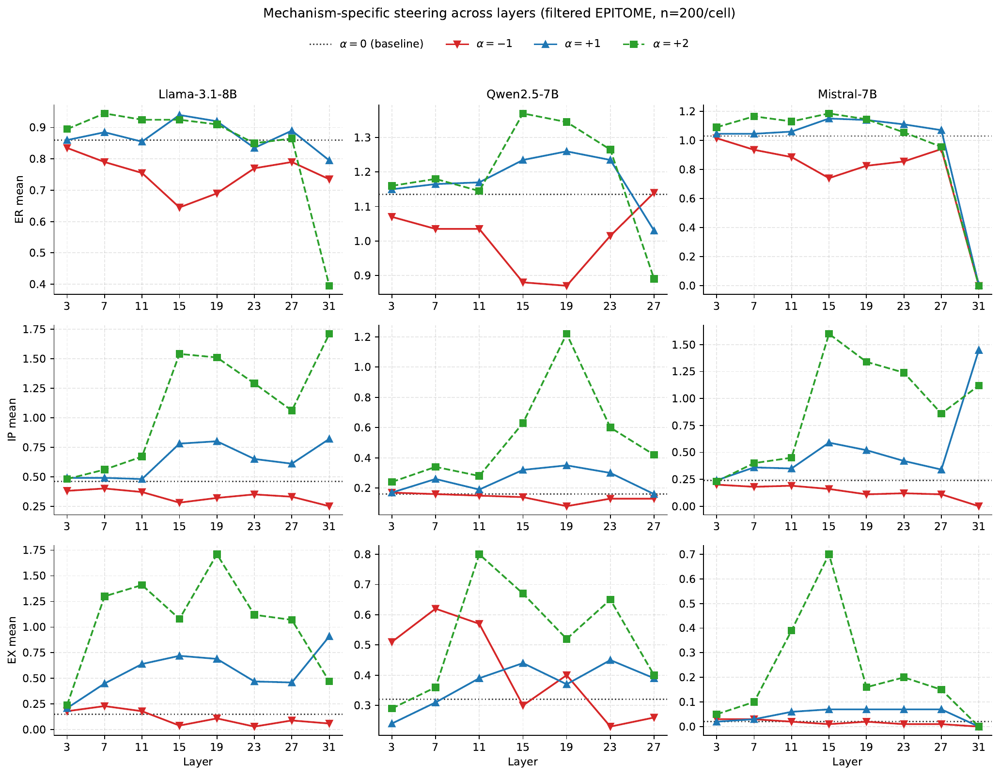
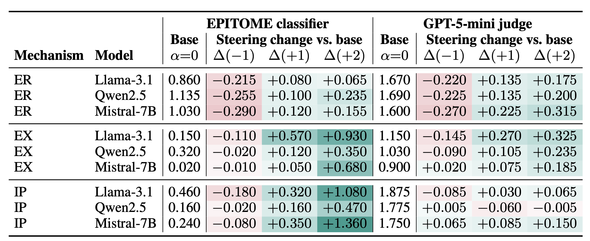
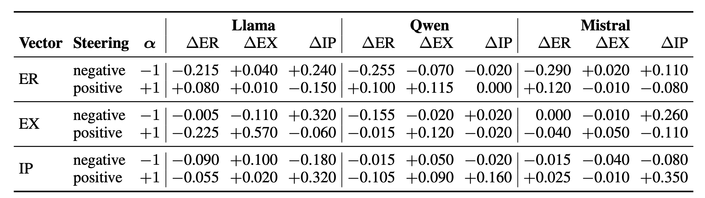
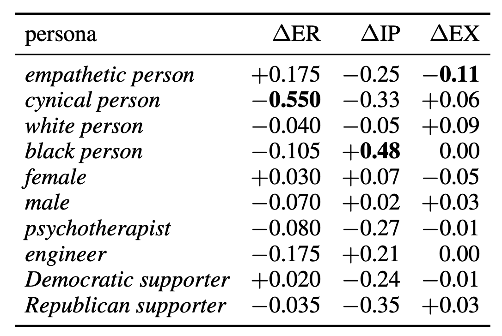
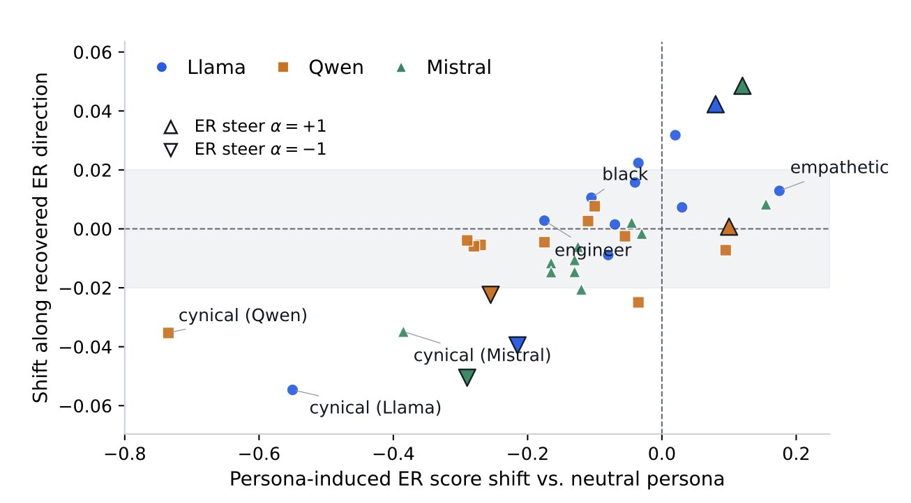
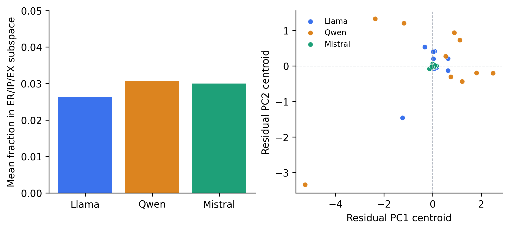

<!-- language:kor -->
# Paper review : Empathy Is Steerable but Multi-Axial

내가 1저자로 참여한 논문 - **Empathy Is Steerable but Multi-Axial:Mechanism Geometry and Persona Effects in LLMs** - 이 EMNLP 2026 Main 에 채택되었다. 

이 연구를 시작하게된 배경, 실험이 어떤 과정을 거쳐 진행되었는지, 실험 결과가 말하고 있는 내용이 무엇인지 소개하고자 한다.

  <a href="https://arxiv.org/abs/2609.15654">
    Paper · arXiv
    <strong class="project-bookmark-title">Empathy Is Steerable but Multi-Axial</strong>
    Mechanism Geometry and Persona Effects in LLMs
    arxiv.org · 2609.15654
  </a>

  <a href="https://hjhj97.github.io/Empathy-Is-Steerable-but-Multi-Axial/">
    Project Page
    <strong class="project-bookmark-title">Empathy Is Steerable but Multi-Axial</strong>
    Mechanism Geometry and Persona Effects in LLMs
    hjhj97.github.io
  </a>

---

## TL;DR

공감하는 답변에도 여러 방식이 있다. 상대의 감정을 인정해주거나, 상황에 대한 이해를 표현하거나, 더 이야기해 달라고 질문할 수 있다. 이 연구는 **Activation steering을 적용한다면 이 중 원하는 표현을 늘리거나 줄일 수 있는지** 밝혀냈다.

응답은 EPITOME라는 기존 공감 평가 기준을 학습한 모델로 점수를 매겼고, 별도의 LLM Judge와도 비교했다.   
주요 결과는 세 가지다.

1. **공감표현은 Steerable 하다:** 3종류 모델 모두에서 내부 계산 값을 바꾸는 것만으로 목표로 한 표현의 점수를 높이거나 낮출 수 있었다.
2. **하지만 원하는 표현만 바뀌지는 않는다:** 예를 들어 질문을 유도(EX)하는 방향으로 조정하면, 질문 관련 점수는 올라갔지만 감정 인정(ER)과 상황 이해 표현(IP)의 점수는 함께 내려갔다.
3. **페르소나 프롬프팅과 공감 표현을 직접 조절하는 것은 다르다:** “`empathetic person`”이나 “`cynical person`”이라는 페르소나를 부여하면 답변이 달라진다. 하지만 페르소나로 생긴 내부 변화의 대부분은 앞서 공감 표현을 조절하던 세 방향만으로 설명되지 않았다.

## 1. 출발점: LLM의 공감을 조절할 수 있을까?

이 연구는 간단한 의문에서 시작한다. LLM은 고민을 들으면 공감해주는 답변을 꽤나 잘 만들어준다. 그렇다면 공감 답변을 생성하는 데 관여하는 activation이 존재하지 않을까 하는 가설에서 시작한다.

 이 activation을 조절하면 공감 표현을 늘리거나 줄일 수 있지 않을까? 그리고 `empathetic person`이나 `cynical person`이라는 페르소나를 부여할 때도 같은 activation이 달라지는 걸까?

**요약하자면, LLM에서 공감 표현을 조절할 수 있는지, 3종류의 공감을 서로 독립적으로 조절할 수 있는지, 그리고 persona에 따른 변화도 같은 방향으로 설명되는지**를 밝혀 내고자 했다.

> 그런데 실험에 앞서 정해야 할 것이 있었다. 무엇을 공감이라고 볼 것인가? 공감을 어떻게 정의할 것인가?

상대가 슬프다는 것을 예측하는 emotion classification과, 슬픈 상대에게 적절한 답변을 생성하는 것은 다르다. “`I'm sorry to hear that`”라고 말한다고 해서 상대가 반드시 공감 받았다고 느끼는 것은 아니다. 같은 말도 상황과 듣는 사람에 따라 다르게 받아들여질 수 있다.

공감적인 답변을 고르는 것과 직접 만드는 것도 다르다고 생각했다. 그래서 MCQ(Multi-Choice Question) 대신 free-form generation을 택하고, 생성된 응답에서 공감 표현을 평가하기로 했다.

### 답변은 많은데 비교하기가 어렵다

초기에는 같은 seeker post(고민 글)에 응답을 여러 개 생성한 뒤, 공감 점수가 높은 응답과 낮은 응답의 activation을 비교하려 했다. 그런데 응답 1,000개를 모아보니 당시 사용한 5점 척도의 LLM-as-a-judge 평가에서 93.6%가 3~4점에 몰렸다.

대부분 무난한 답변으로 평가되다 보니, 비교에 쓸 만큼 점수가 다른 응답을 찾기 어려웠다. 데이터를 많이 생성해도 원하는 비교가 가능한 것은 아니었다. 프롬프트로 공감적/중립적 응답을 만들 수도 있었지만, activation 차이가 공감 때문인지 instruction, 문체, 길이 때문인지 구분하기 어려웠다.

최종 실험에서는 사람이 공감 표현의 범주와 강도를 구분해 놓은 EPITOME를 사용했다. 초기에 사용한 5점 평가 대신, EPITOME의 0/1/2 라벨을 기준으로 비교 집단을 만들었다.

예를 들어 "That must have been really hard to go through."라는 답변에는 상대의 감정을 인정하는 표현(ER)은 있지만, 더 이야기해 달라고 묻거나 요청하는 표현(EX)은 없다. 이처럼 한 답변에 어떤 공감 표현은 있고, 다른 표현은 없을 수 있다. 그래서 답변 전체를 공감적이거나 비공감적인 것으로 나누는 대신, ER/IP/EX 각각의 표현이 있는 응답과 없는 응답을 비교했다. EPITOME에는 세 범주의 라벨이 따로 붙어 있어, 이 기준에 맞춰 응답을 고를 수 있었다.

## 2. 논문에서 말하는 공감: ER, EX, IP

EPITOME는 [Sharma et al. (2020)](https://aclanthology.org/2020.emnlp-main.425/)이 온라인 정신건강 지원 대화에서 공감이 어떻게 표현되는지 분석하기 위해 제안한 프레임워크다. 작성된 seeker post에 대해 다른 사람이 답하는 peer-support dialogue를 대상으로, **답변이 어떤 방식으로 공감을 전달하는지**를 3 가지 범주로 나눈다.

| 범주 | 응답에서 관찰하는 특성 |  예시 |
|---|---|---|
| Emotional Reactions, `ER` | 상대의 감정을 인정하거나 정서적으로 반응하는 표현 | "That must have been really hard to go through."  |
| Interpretations, `IP` | 상대가 겪은 상황에 대한 이해나 해석을 표현하는 것 | "It sounds like you feel disappointed because you had high hopes." |
| Explorations, `EX` | 질문이나 요청을 통해 상대가 더 이야기하도록 유도하는 것 | "What has been the hardest part for you?" |

하나의 응답에 ER, IP, EX 점수를 각각 매기므로, 전체 공감 점수 하나로는 드러나지 않는 표현의 차이를 비교할 수 있다. 원 연구에서는 사람이 seeker post와 응답을 함께 읽고, 각 범주의 표현이 없으면 0, 약하면 1, 강하면 2로 라벨을 붙였다. 이 human annotation을 학습해 새로운 응답의 점수를 예측하는 RoBERTa 기반 classifier도 개발했다.

이번 연구에서는 Reddit 데이터의 사람 라벨로 벡터 추출용 응답을 고르고, 생성된 새 응답은 기존 classifier로 평가했다. EPITOME의 데이터와 평가 모델을 서로 다른 단계에 사용한 것이다.

실험에서 확인하려는 것은 다음과 같다.

> ER, IP, EX 각각에 해당하는 activation direction을 만들면, 다른 두 점수는 유지하면서 원하는 점수만 바꿀 수 있을까?

*Figure 1. 같은 seeker post에 ER, EX, IP steering을 적용해 각각 감정, 질문, 상황 해석에 해당하는 표현이 추가되었다.*

## 3. Method: activation 차이로 steering vector 추출

이번 실험에는 [Contrastive Activation Addition(CAA)](https://aclanthology.org/2024.acl-long.828/)을 사용했다. 원하는 특성이 있는 예시와 없는 예시의 평균 activation 차이를 벡터로 만들고, 생성 중 내부 activation에 더해 모델의 응답을 조절하는 기법이다. 모델의 가중치는 그대로 두고, 벡터에 곱하는 계수의 부호와 크기로 개입 방향과 강도를 조절한다. 여기서는 ER, IP, EX 각각의 표현 유무를 기준으로 벡터를 만들었다.

Llama-3.1-8B-Instruct, Qwen2.5-7B-Instruct, Mistral-7B-Instruct에서 실험했다. EPITOME에서 100자 미만이거나 자해 keyword를 포함한 seeker post는 모델이 답변을 거부할 확률이 높아지므로 제외하고 실험했다.

각 범주에서 표현이 있는 응답(라벨 1,2)과 없는 응답(라벨 0)을 각각 100개씩 뽑았다.

벡터를 추출할 때는 모델에게 새로운 답변을 만들게 하지 않는다. seeker post와 기존 응답을 teacher forcing으로 읽게 하고, 그 과정에서 계산되는 내부 수치값인 activation을 기록한다. 구체적으로는 각 layer의 마지막 response token hidden state를 추출한다.

응답마다 얻은 activation을 두 집단별로 평균하고, 표현이 있는 집단의 평균에서 없는 집단의 평균을 뺀다. 범주 $m$, layer $\ell$에서 이 차이가 steering vector(empathy vector)다.

$$
v_\ell^m
= \operatorname{mean}_{x \in P_m} h_\ell(x)
- \operatorname{mean}_{x \in N_m} h_\ell(x).
$$

이 **candidate direction**에는 다른 공감 범주나 문체와 내용의 영향도 섞일 수 있어, 뒤의 대조 실험에서 확인한다. 새로운 응답을 생성할 때는 선택한 layer의 현재 마지막 token activation에 벡터를 더한다.

벡터가 준비되면, 이번에는 새로운 seeker post에 모델이 직접 응답을 생성하게 한다. 기존 응답을 읽으며 내부 값을 기록했던 추출 단계와 달리, 생성 단계에서는 선택한 layer의 현재 마지막 token activation에 벡터를 더한다.

$$
h_{\ell,t} \leftarrow h_{\ell,t} + \alpha v_\ell^m.
$$

$\alpha$는 steering strength로, $-1, 0, +1, +2$를 비교했다. 0은 개입하지 않는 baseline, 양수와 음수는 벡터를 더하거나 빼는 조건이다. 여러 layer에서 조건별로 200개 seeker post의 응답을 평가했다. 재학습이나 추가 공감 지시 없이 activation 개입만 바꿨으며, 벡터 추출과 평가 데이터는 분리했다.

## 4. Result 1: 세 모델 모두 layer 15에서 steerable

*Figure 3. 중간 layer에서 비교적 일관된 steering 효과가 나타난다. 효과가 가장 큰 layer와 후반 layer의 반응은 모델,범주,강도에 따라 다르다.*

Table 1은 layer 15의 target score와 baseline 대비 변화량을 보여준다. 각 행은 해당 범주의 벡터로 steering한 결과다.

*Table 1. 왼쪽은 EPITOME classifier, 오른쪽은 GPT-5-mini judge의 평가다.*

어느 layer에서 steering이 가장 잘 작동하는지 확인하기 위해, layer 3부터 7, 11, 15, ... 순으로 4개 간격의 layer sweep을 진행했다. 그 결과 **탐색한 layer 중 세 모델의 ER, EX, IP를 모두 양방향으로 조절하기에 가장 적합한 지점은 layer 15였다.** 초반 layer에서는 변화가 작거나 개입 방향과 맞지 않는 경우가 있었다.    

후반에는 더 큰 효과가 나타나는 조건도 있었지만, 모델과 범주에 따라 반응이 달라지고 마지막 layer에서는 점수를 높이려는 개입이 오히려 점수를 떨어뜨리기도 했다. Layer 15에서는 세 모델의 세 범주 모두 의도한 방향으로 점수가 움직여, 이후 분석의 공통 개입 지점으로 선택했다.

왜 중간 layer에서 이런 일관성이 나타날까? 한 가지 해석은 **응답의 행동적 특성을 조절할 표현이 형성되어 있으면서, 개입을 반영할 후속 layer도 남아 있기 때문**이라는 것이다. 초반에는 이런 표현이 아직 충분히 형성되지 않았을 수 있고, 마지막 layer에서는 개입이 다음 토큰의 logit에 직접 영향을 주어 점수 변화가 불안정해질 수 있다.   
[CAA 선행연구](https://aclanthology.org/2024.acl-long.828/)에서도 행동을 구분하는 표현이 중간 layer 부근에서 나타나고, steering 효과도 이 구간에서 크게 관찰됐다.

세 모델의 ER, EX, IP 모두 양의 steering에서는 점수가 올라가고, 음의 steering에서는 내려갔다. Llama의 EX를 예로 들면 baseline 0.15가 $\alpha=+1$에서 0.72로 올라가고, $\alpha=-1$에서는 0.04로 내려간다.

Mistral EX의 $+0.05$와 Llama EX의 $+0.57$처럼, 방향은 같아도 효과 크기는 모델과 범주에 따라 다르다. 또 모델마다 깊이와 내부 표현이 다르므로 같은 layer 번호가 같은 기능을 뜻하지는 않는다. 이 실험에서 확인한 것은 **세 모델에서 공통적으로 나타나는 steerablility**이다.

## 5. Result 2: 원하는 점수만 바뀌지는 않았다

Target score가 올라간 것까지 확인했으니, 나머지 두 점수도 살펴보자.    
Table 2의 양의 EX steering에서 세 모델에 공통된 패턴이 나타난다.

*Table 2. Layer 15에서 ER, EX, IP 벡터로 양·음의 steering을 적용한 결과다. 각 값은 같은 벡터 실험의 $\alpha=0$ 대비 점수 변화다.*

EX 벡터로 개입하자 질문이나 추가 설명을 요청하는 표현의 점수는 높아졌다. 그런데 세 모델 모두에서 감정(ER)과 이해 표현(IP)의 점수는 오히려 낮아졌다. Llama에서는 EX가 $0.570$ 오른 반면, ER은 $0.225$, IP는 $0.060$ 떨어졌다.

질문만 늘리려던 개입이 다른 공감 표현까지 함께 바꾼 것이다. ER이나 IP를 조절할 때도 목표로 하지 않은 점수가 함께 변했다. 함께 변하는 점수와 그 변화의 방향은 모델과 사용한 벡터에 따라 달랐다.

### Cosine similarity는 무엇을 보여주는가?

Layer 15의 원래 벡터 사이 cosine은 다음과 같다.

| 벡터 쌍 | Llama | Qwen | Mistral |
|---|---:|---:|---:|
| ER–EX | +0.08 | +0.13 | +0.09 |
| ER–IP | -0.29 | -0.32 | -0.25 |
| EX–IP | -0.45 | -0.46 | -0.53 |

ER–EX의 cosine은 0에 가깝고, ER–IP와 EX–IP는 음수다. 세 모델이 같은 벡터를 공유하는 것은 아니지만, **각 모델 내부에서 세 벡터간의 기하적 관계는 비슷했다.**

흥미로운 점은 ER과 EX가 거의 직교하는데도 EX steering이 ER을 낮춘다는 것이다. 벡터가 직교한다고 출력도 독립적으로 바뀌는 것은 아니다. 개입 이후의 모델 연산과 문장 구성, classifier의 평가 방식도 점수에 영향을 줄 수 있다.

반대로 벡터가 직교하지 않는다고 해서 selective control이 근본적으로 불가능한 것은 아니다. Non-orthogonal과 linearly dependent는 다르다. 이번 결과에서 확인한 것은 추출한 CAA 벡터를 하나씩 사용했을 때 다른 점수도 함께 변한다는 사실이다.

### 프롬프트로 지시하면 되지 않을까?

추가 지시가 없는 P0와 일반 공감(P1), 감정 인정(P2), 상황 이해,후속 질문(P3)을 요청하는 조건도 비교했다. Llama의 P2는 P0 대비 ER을 $+0.45$ 높이지만 IP는 $-0.09$, EX는 $-0.07$ 변해, 직접 작성한 instruction 역시 원하는 범주만 따로 조절하지는 못했다. 

## 6. 공유 성분의 역할

### Residualization: 공유 성분을 빼면 어떻게 될까?

Cosine으로는 벡터 사이의 관계를 볼 수 있지만, 겹치는 부분이 실제 steering에 필요한지는 알 수 없다. 이를 확인하기 위해 각 벡터에서 다른 두 벡터의 span에 포함되는 성분을 제거한 뒤 다시 steering했다.

이때 residual vector의 norm을 원래 벡터와 같게 맞춘 뒤 개입한다. 그래야 효과가 달라진 이유가 공유 성분을 제거했기 때문인지, 벡터가 작아졌기 때문인지 구분할 수 있다.

Llama layer 15, $\alpha=+1$의 결과는 다음과 같다.

| 범주 | 원래 target 변화량 | Residualization 후 변화량 | 원래 효과 대비 유지율 |
|---|---:|---:|---:|
| ER | +0.080 | +0.105 | 131.3% |
| EX | +0.570 | +0.480 | 84.2% |
| IP | +0.320 | +0.160 | 50.0% |

ER 효과는 유지되고 EX는 약 84%, IP는 50%가 남는다. Norm을 복원했는데도 EX/IP 효과가 줄었으므로, 이를 단순히 벡터 크기가 줄어든 결과로 설명할 수는 없다. 제거한 공유 성분도 steering에 기여한다는 뜻이다. 각 방향에 남는 성분으로도 점수를 바꿀 수 있지만, 공유 성분을 없앤다고 더 좋은 제어가 되는 것은 아니다.

### 데이터 구성 때문에 생긴 overlap은 아닐까?

여기서 한 가지를 더 확인했다. 다른 공감 점수까지 함께 바뀐 이유가, 벡터를 만들 때 비교한 두 응답 집단의 차이 때문은 아닐까?

IP vector는 상황을 이해하는 표현(IP)이 있는 응답과 없는 응답의 activation 차이로 만든다. 그런데 IP가 있는 집단에 감정 인정(ER)이나 질문(EX)도 더 많았다면, 이 벡터에는 IP뿐 아니라 ER과 EX의 차이까지 담길 수 있다. IP를 조절하려고 만든 벡터가 다른 점수까지 바꾸는 이유가 여기에 있을 수도 있다.

그래서 같은 데이터 후보군에서 응답을 골라 두 조건을 비교했다. IP vector를 예로 들면 다음과 같다.

- **Unmatched:** IP 표현이 있는 집단과 없는 집단을 만들되, ER과 EX 라벨의 분포는 따로 맞추지 않는다.
- **Exact-matched:** IP 표현의 유무는 그대로 구분하면서, ER과 EX 라벨의 조합별 응답 수를 두 집단에서 같게 맞춘다. 예를 들어 ER=2, EX=0인 응답을 두 집단에 같은 수만큼 넣고, 나머지 조합도 같은 방식으로 맞춘다.

즉, 다른 두 범주의 라벨 분포를 같게 맞춘 뒤에도 목표 점수를 바꿀 수 있는지, 다른 점수가 함께 변하는지도 확인하는 실험이다. ER과 EX vector에도 같은 방법을 적용했다. 조절할 범주의 라벨별 응답 수, 평가에 쓰는 seeker post 200개, decoding 설정은 두 조건에서 동일하게 유지했다. 아래는 Llama layer 15에서 양의 steering을 적용한 결과다.

| 범주 | Unmatched target 변화량 | Exact-matched target 변화량 |  95% CI |
|---|---:|---:|---|
| ER | +0.030 | +0.065 | [-0.030, +0.100] |
| EX | +0.680 | +0.610 | [-0.230, +0.090] |
| IP | +0.290 | +0.270 | [-0.170, +0.130] |

Non-target label을 맞춘 뒤에도 세 target score는 모두 올라간다. 다른 라벨의 불균형만으로 steering 효과가 생겼던 것은 아닌 셈이다.

반면 일부 coupling은 약해진다. EX steering에 따른 ER 감소는 $-0.12$에서 $-0.05$로 줄었다. 두 조건의 차이는 $+0.07$이고, 95% CI는 $[0.005, 0.135]$다. ER–IP와 EX–IP cosine도 0에 가까워진다.

정리하면 다음과 같다.

> 다른 라벨의 분포를 맞춰도 목표 점수는 조절할 수 있다. 다만 다른 점수가 함께 변하는 정도와 벡터 사이의 관계는 어떤 응답으로 벡터를 만들었는지에 영향을 받는다.

## 7. Result 3: Persona도 같은 공감 방향을 움직일까?

이번에는 모델에 persona(페르소나)를 부여한다. 페르소나를 부여하면 공감 점수가 바뀌는지, 그때 activation도 앞에서 찾은 ER/IP/EX direction을 따라 변하는지 확인한다.

Baseline은 `person`이다. 여기에 `empathetic`/`cynical`의 두 persona와 성별·인종·직업·정치 성향에 해당하는 8개의 social persona를 비교했다. Baseline까지 포함하면 총 11개 조건이다.

Table 4의 Llama 결과를 보면, persona에 따라 세 점수가 서로 다르게 변한다.

*Table 4. Llama-3.1-8B-Instruct에 10가지  persona를 부여했을 때의 점수 변화. Baseline은 `person`.*

'`empathetic person`'페르소나를 줘도 ER만 올라가고($+0.175$), IP($-0.250$)와 EX($-0.110$)는 내려간다. 전체 응답 품질과는 별개로, persona가 세 공감 표현을 함께 늘리지는 않은 것이다. `black person`과 `engineer`에서는 ER이 내려가고 IP가 올라간다. 

### 점수가 달라지면 ER 방향으로도 움직일까?

페르소나별 생성 응답의 layer-15 activation을 response token들에 걸쳐 평균한 뒤, ER vector와의 cosine을 구한다. `person` 대비 ER 점수 변화와 cosine 변화를 비교한 것이 Figure 4다.

*Figure 4. 작은 점은 persona 조건, 큰 삼각형은 직접 ER steering한 조건이다. 가로축은 ER 점수 변화, 세로축은 ER vector와의 cosine 변화다.*

Persona에 따라 ER 점수는 크게 달라지지만 ER 방향의 cosine 변화는 작다. **Persona effect는 추출한 ER 방향 하나로 충분히 설명되지 않는다.** 

### 3% 수치가 말하고 있는 것

ER뿐 아니라 IP와 EX까지 포함하면 어떨까? 세 벡터가 만드는 subspace로 분석을 넓혔다.

같은 seeker post에서 persona와 baseline `person`의 layer-15 response representation 차이를 평균한 뒤, **평균 shift의 squared norm 중 ER/IP/EX span에 포함되는 비율**을 구했다. 아래는 baseline을 제외한 열 개 persona의 비율을 평균한 결과다.

| 모델 | ER/IP/EX span에 포함되는 비율 | Span 밖에 남는 비율 | Residual의 상위 5개 PC 설명 분산 |
|---|---:|---:|---:|
| Llama | 2.64% | 97.36% | 27.49% |
| Qwen | 3.08% | 96.92% | 29.60% |
| Mistral | 3.00% | 97.00% | 29.86% |

*Figure 6. Persona별 평균 shift의 ER/IP/EX span 포함 비율(왼쪽)과 span 밖 residual의 PCA(오른쪽).*

Persona를 부여하면 공감 점수가 달라지니, 그때의 activation도 앞서 찾은 ER/IP/EX 방향을 따라 움직일 것이라 예상했다. 하지만 persona별 평균 activation 변화의 squared norm 중 약 97%는 이 세 벡터로 포착되지 않았다. 공감 점수를 조절할 수 있는 방향을 찾았지만, persona가 만드는 내부 변화는 그 범위를 넘어섰다.

## 8. 실험 신뢰성 검증

**Seed를 바꾸거나 다른 데이터에 적용해도 steering 방향이 유지되는지** 확인했다.

- **반복 검증:** Llama layer 15에서 extraction/sample seed와 decoding seed를 바꿔도 부호가 유지됐다. 논문 Appendix G의 target 효과 18개 검정은 모두 CI가 0을 배제하고 Holm 보정 후에도 유의했다. 모든 모델의 off-target 효과까지 검증한 결과는 아니다.
- **Cross-Judging:** GPT-5-mini와 EPITOME classifier의 ER 방향은 일치하고 EX도 대체로 일치했지만, IP는 불일치가 남았다. 둘은 같은 EPITOME rubric을 사용하며 human evaluation을 대체하지 않는다.
- **OOD(Out-Of-Domain) Validation:** EmpatheticDialogues의 negative-emotion subset에서도 세 모델의 ER steering 방향이 양·음 모두 유지됐다. ER만 EPITOME classifier로 평가한 결과다.

응답 길이와 질문 수를 통제하자, 세 모델을 합친 양의 EX steering 효과는 $+0.248$에서 $-0.004$로 줄었다. **질문과 추가 설명 요청을 평가하는 EX의 점수 변화는 응답 길이와 질문 수의 변화에 밀접하게 연결되어 있었다.**

Steering이 일반적인 텍스트 예측에도 영향을 주는지는 PPL(perplexity)로 확인했다. PPL은 주어진 글의 다음 token을 얼마나 잘 예측하는지 나타내는 지표로, 낮을수록 좋다. Llama로 WikiText-103의 4,096 tokens를 평가했을 때, $\alpha=+1$에서는 PPL이 조금 올라갔고 EX steering을 $\alpha=+2$로 높이면 더 크게 올라갔다. EX 개입을 강하게 했을 때 일반 텍스트의 다음 token을 예측하는 성능도 더 떨어진 것이다.

## 9. 정리
결론을 한 문장으로 정리하자면,

> **공감 표현은 steering할 수 있다. 다만 원하는 표현만 따로 조절되지는 않으며, 추출한 세 방향만으로 persona effect 전체를 설명할 수 없다.**

실험 방법은 기존 CAA를 사용했다. 여기서 확인한 것은 **target steerability, selective control, persona shift의 coverage가 서로 다른 문제**라는 점이다. 세 모델 모두 target score는 움직였지만, 공유 성분을 제거하면 일부 효과가 약해졌고 persona 변화의 대부분은 세 방향 밖에 남았다. 다른 공감 범주의 라벨 분포를 맞춰도 목표 점수는 여전히 조절됐다. 반면 다른 점수가 함께 변하는 현상은 일부 줄었다. 어떤 응답으로 벡터를 만드느냐가 조절 결과에도 영향을 준 것이다.

연구를 시작할 때는 공감에 관여하는 activation을 찾아 바꾸면 될 것 같았다. 실제로는 비교할 응답을 확보하는 일부터 쉽지 않았다. Human-labeled EPITOME를 택하고, target뿐 아니라 non-target score를 보고, persona의 변화까지 따라가면서 질문도 구체적으로 바뀌었다.

마지막으로 이번 연구와 같은 AI와 human emotion을 결합한다는 아이디어는 정말 매력적이지만 정말 신경써야 할 것이 많다. 일단 감정이라는 개념을 evaluation 하기가 까다로운데, 인간의 자연스러운 감정을 discrete한 지표로 표현해야 한다는 점, 그리고 무엇보다 감정은 ground truth를 상정하기 어렵다. 

감정에서의 정답은 사람마다 생각하는 가치관이 각자 다르기 때문에 EPITOME 같은 이미 사전 검증된 데이터를 갖고 오거나, 아니면 새로운 개념을 제안할 것이라면 human annotation 과정이 필수로 들어가야 한다. 나도 이번 연구를 하면서도 공감을 어떻게 해야 measurable 한 영역으로 끌고 올 수 있는지를 끊임없이 고민했던 것 같다. 

<!-- language:eng -->

# Paper Review: Empathy Is Steerable but Multi-Axial

Our paper, **Empathy Is Steerable but Multi-Axial: Mechanism Geometry and Persona Effects in LLMs**, on which I am the first author, was accepted to the EMNLP 2026 Main Conference.

In this post, I explain what motivated the research, how the experiments developed, and what the results tell us.

  <a href="https://arxiv.org/abs/2609.15654">
    Paper · arXiv
    <strong class="project-bookmark-title">Empathy Is Steerable but Multi-Axial</strong>
    Mechanism Geometry and Persona Effects in LLMs
    arxiv.org · 2609.15654
  </a>

  <a href="https://hjhj97.github.io/Empathy-Is-Steerable-but-Multi-Axial/">
    Project Page
    <strong class="project-bookmark-title">Empathy Is Steerable but Multi-Axial</strong>
    Mechanism Geometry and Persona Effects in LLMs
    hjhj97.github.io
  </a>

---

## TL;DR

There are several ways to respond empathetically. A response might acknowledge someone's feelings, express an understanding of their situation, or ask them to share more. This study investigated **whether activation steering can increase or decrease a particular kind of empathetic expression**.

We scored responses using a model trained on EPITOME, an existing framework for evaluating empathy, and compared those scores with evaluations from a separate LLM judge.

There are three main findings.

1. **Empathetic expressions are steerable:** In all three models, changing internal activations alone could increase or decrease scores for the targeted expression.
2. **But the changes are not limited to the target:** For example, steering toward asking questions (EX) increased the corresponding score, but also decreased scores for acknowledging emotions (ER) and expressing an understanding of the situation (IP).
3. **Persona prompting is different from directly steering empathetic expressions:** Assigning a persona such as `empathetic person` or `cynical person` changes the response. However, most of the internal changes induced by personas could not be explained by the three directions used to steer empathetic expressions.

## 1. Starting Point: Can We Steer Empathy in LLMs?

This research began with a simple question. LLMs are quite good at generating seemingly empathetic responses when someone shares a concern. That led to a hypothesis: might there be activations involved in generating these responses?

Could we increase or decrease empathetic expressions by adjusting those activations? And would the same activations change when we assigned a persona such as `empathetic person` or `cynical person`?

**In short, we wanted to find out whether empathetic expressions in LLMs are controllable, whether three categories of empathy can be controlled independently, and whether persona-induced changes can be explained by the same directions.**

> Before running experiments, however, we had to settle a more basic question: what counts as empathy? How should we define it?

Emotion classification, such as predicting that someone is sad, is different from generating an appropriate response to that person. Saying "`I'm sorry to hear that`" does not necessarily make the recipient feel understood. The same words can be received differently depending on the situation and the person hearing them.

I also felt that choosing an empathetic response was different from generating one. We therefore chose free-form generation rather than multiple-choice questions (MCQs), and evaluated empathetic expressions in the generated responses.

### Plenty of Responses, but Few Useful Comparisons

Initially, we planned to generate multiple responses to the same seeker post, meaning a post from someone seeking support, and compare the activations of high- and low-empathy responses. But after collecting 1,000 responses, we found that 93.6% received a score of 3 or 4 on the five-point LLM-as-a-judge scale we were using.

Because most responses were judged to be reasonably acceptable, it was difficult to find responses with sufficiently different scores for a useful comparison. Generating more data did not necessarily give us the contrast we needed. We could also prompt the model to produce empathetic or neutral responses, but then it was hard to tell whether activation differences reflected empathy, the instructions, writing style, or response length.

For the final experiments, we used EPITOME, whose human annotations distinguish the categories and strength of empathetic expressions. Instead of the initial five-point evaluation, we constructed comparison groups using EPITOME's 0/1/2 labels.

For example, "That must have been really hard to go through." acknowledges the other person's feelings (ER), but does not ask or invite them to say more (EX). A response can contain one kind of empathetic expression without containing another. Rather than divide entire responses into empathetic and non-empathetic groups, we therefore compared responses with and without each of ER, IP, and EX. EPITOME provides separate labels for all three categories, allowing us to select responses on that basis.

## 2. What Empathy Means in This Paper: ER, EX, IP

EPITOME is a framework proposed by [Sharma et al. (2020)](https://aclanthology.org/2020.emnlp-main.425/) to analyze how empathy is expressed in online mental health support conversations. In peer-support dialogues, where someone responds to a seeker post, it distinguishes three categories of **how a response conveys empathy**.

| Category | Observable characteristics of the response | Example |
|---|---|---|
| Emotional Reactions, `ER` | Acknowledging the other person's feelings or responding emotionally | "That must have been really hard to go through." |
| Interpretations, `IP` | Expressing an understanding or interpretation of the other person's situation | "It sounds like you feel disappointed because you had high hopes." |
| Explorations, `EX` | Using questions or requests to encourage the other person to share more | "What has been the hardest part for you?" |

Each response receives separate ER, IP, and EX scores, making it possible to compare differences in expression that a single overall empathy score would miss. In the original study, human annotators read the seeker post together with the response and assigned a label of 0 when a category was absent, 1 when it was weakly expressed, and 2 when it was strongly expressed. The authors also developed a RoBERTa-based classifier trained on these annotations to predict scores for new responses.

In our study, we used the human labels in the Reddit data to select responses for vector extraction, and used the existing classifier to evaluate newly generated responses. EPITOME's data and evaluation model thus served different roles at different stages.

The question we wanted to test was:

> If we construct an activation direction for each of ER, IP, and EX, can we change the target score while keeping the other two scores unchanged?

*Figure 1. Applying ER, EX, and IP steering to the same seeker post adds expressions related to emotions, questions, and interpretations of the situation, respectively.*

## 3. Method: Extracting Steering Vectors from Activation Differences

We used [Contrastive Activation Addition (CAA)](https://aclanthology.org/2024.acl-long.828/) in these experiments. CAA constructs a vector from the difference in mean activations between examples with and without a desired property, then adds it to internal activations during generation to steer the model's responses. The model's weights remain unchanged, while the sign and magnitude of a coefficient determine the direction and strength of the intervention. Here, we constructed separate vectors based on the presence or absence of ER, IP, and EX expressions.

We ran experiments with Llama-3.1-8B-Instruct, Qwen2.5-7B-Instruct, and Mistral-7B-Instruct. We excluded EPITOME seeker posts shorter than 100 characters or containing self-harm keywords, as these posts could make the models more likely to refuse to respond.

For each category, we selected 100 responses containing the expression (labels 1 or 2) and 100 responses without it (label 0).

During vector extraction, the model does not generate a new response. Instead, we feed it the seeker post and an existing response using teacher forcing, and record the activations computed as it reads them. Specifically, we extract the hidden state of the last response token at each layer.

We average the response activations within each group, then subtract the mean for the group without the expression from the mean for the group with it. For category $m$ at layer $\ell$, this difference is the steering vector, or empathy vector.

$$
v_\ell^m
= \operatorname{mean}_{x \in P_m} h_\ell(x)
- \operatorname{mean}_{x \in N_m} h_\ell(x).
$$

This **candidate direction** may also capture other empathy categories, writing style, or content, so we examine those possibilities in later control experiments. When generating a new response, we add the vector to the activation of the current last token at the selected layer.

Once the vector is ready, we let the model generate its own response to a new seeker post. Unlike the extraction stage, which records internal values while the model reads an existing response, the generation stage adds the vector to the current last-token activation at the selected layer.

$$
h_{\ell,t} \leftarrow h_{\ell,t} + \alpha v_\ell^m.
$$

$\alpha$ is the steering strength. We compared $-1, 0, +1, +2$: zero is the baseline without intervention, while positive and negative values add or subtract the vector. We evaluated responses to 200 seeker posts per condition across multiple layers. We changed only the activation intervention, without retraining or adding instructions to be empathetic, and kept the data for vector extraction separate from the evaluation data.

## 4. Result 1: All Three Models Are Steerable at Layer 15

*Figure 3. Steering effects are relatively consistent in the middle layers. The layer with the largest effect, and the behavior of later layers, vary by model, category, and strength.*

Table 1 shows the target scores at layer 15 and their changes relative to the baseline. Each row reports steering with the vector for the corresponding category.

*Table 1. Evaluations by the EPITOME classifier on the left and the GPT-5-mini judge on the right.*

To find where steering worked best, we swept through layers at intervals of four, starting with layers 3, 7, 11, 15, and so on. **Among the layers we tested, layer 15 was the most suitable common point for steering ER, EX, and IP in both directions across all three models.** At earlier layers, changes were sometimes small or inconsistent with the intended direction.

Some conditions produced larger effects at later layers, but the responses varied by model and category. At the final layer, an intervention intended to increase a score sometimes decreased it instead. At layer 15, all three categories in all three models moved in the intended direction, so we selected it as the common intervention point for subsequent analyses.

Why might the middle layers show this consistency? One interpretation is that **representations relevant to the behavioral properties of responses have formed by this point, while enough downstream layers remain to incorporate the intervention**. These representations may not yet be sufficiently developed in earlier layers. At the final layer, an intervention can directly affect next-token logits, potentially making score changes less stable. [Earlier work on CAA](https://aclanthology.org/2024.acl-long.828/) also found representations distinguishing behaviors around the middle layers, with substantial steering effects in that region.

For ER, EX, and IP in all three models, positive steering increased scores and negative steering decreased them. For example, Llama's EX score rose from a baseline of 0.15 to 0.72 at $\alpha=+1$, and fell to 0.04 at $\alpha=-1$.

Even when the direction is the same, the effect size varies by model and category, as illustrated by $+0.05$ for Mistral EX and $+0.57$ for Llama EX. Moreover, models differ in depth and internal representations, so the same layer number does not necessarily imply the same function. What this experiment established was **steerability shared across all three models**.

## 5. Result 2: The Changes Are Not Limited to the Target

Having confirmed that the target score increased, we can now look at the other two scores. Table 2 reveals a common pattern across the three models under positive EX steering.

*Table 2. Positive and negative steering with ER, EX, and IP vectors at layer 15. Each value is the score change relative to $\alpha=0$ in the experiment using the same vector.*

Intervening with the EX vector increased scores for questions and requests for further explanation. Yet scores for emotional reactions (ER) and expressions of understanding (IP) decreased in all three models. In Llama, EX increased by $0.570$, while ER fell by $0.225$ and IP by $0.060$.

An intervention intended to increase questions had also changed other empathetic expressions. Steering ER or IP likewise affected non-target scores. Which scores changed together, and in which direction, depended on the model and the vector used.

### What Does Cosine Similarity Show?

The cosine similarities between the original vectors at layer 15 are:

| Vector pair | Llama | Qwen | Mistral |
|---|---:|---:|---:|
| ER–EX | +0.08 | +0.13 | +0.09 |
| ER–IP | -0.29 | -0.32 | -0.25 |
| EX–IP | -0.45 | -0.46 | -0.53 |

ER–EX cosine similarity is close to zero, while ER–IP and EX–IP similarities are negative. The three models do not share the same vectors, but **the geometric relationships among the three vectors within each model were similar**.

Interestingly, EX steering lowers ER even though the ER and EX vectors are nearly orthogonal. Orthogonal vectors do not necessarily produce independent changes in the output. The model's computations after the intervention, how it constructs its responses, and the classifier's evaluation can all affect the scores.

Conversely, non-orthogonal vectors do not make selective control fundamentally impossible. Non-orthogonality and linear dependence are different properties. What these results establish is that using the extracted CAA vectors one at a time also changes other scores.

### Could We Just Use Instructions Instead?

We also compared a condition with no additional instruction (P0) against instructions requesting general empathy (P1), emotional acknowledgment (P2), and situational understanding and follow-up questions (P3). For Llama, P2 increased ER by $+0.45$ relative to P0, but also changed IP by $-0.09$ and EX by $-0.07$. Directly written instructions therefore did not isolate the desired category either.

## 6. The Role of Shared Components

### Residualization: What Happens When We Remove Shared Components?

Cosine similarity tells us how the vectors relate geometrically, but not whether their overlapping components are needed for steering. To test this, we removed from each vector the component lying in the span of the other two vectors, then applied steering again.

Before intervening, we rescaled the residual vector to match the original vector's norm. This allows us to distinguish the effect of removing a shared component from the effect of simply making the vector smaller.

The results for Llama at layer 15 with $\alpha=+1$ are:

| Category | Original target change | Change after residualization | Effect retained relative to the original |
|---|---:|---:|---:|
| ER | +0.080 | +0.105 | 131.3% |
| EX | +0.570 | +0.480 | 84.2% |
| IP | +0.320 | +0.160 | 50.0% |

The ER effect was preserved, while about 84% of the EX effect and 50% of the IP effect remained. Since the EX/IP effects decreased even after restoring the norm, the reduction cannot be explained simply by a smaller vector magnitude. The removed shared components also contribute to steering. The components remaining in each direction can still change scores, but removing shared components does not necessarily produce better control.

### Could the Overlap Come from How the Data Were Constructed?

We checked one more possibility: could the changes in other empathy scores be caused by differences between the two groups of responses used to construct the vectors?

The IP vector is built from the activation difference between responses with and without expressions of situational understanding (IP). But if the group with IP also contains more emotional acknowledgment (ER) or questions (EX), the vector could capture ER and EX differences as well. That could explain why a vector intended to control IP also changes other scores.

We therefore selected responses from the same candidate data pool and compared two conditions. Using the IP vector as an example:

- **Unmatched:** Construct groups with and without IP expressions, without separately matching the distributions of ER and EX labels.
- **Exact-matched:** Keep the distinction between responses with and without IP, but match the number of responses for every combination of ER and EX labels across the two groups. For instance, include the same number of responses with ER=2 and EX=0 in both groups, and do the same for all other combinations.

In other words, this experiment tests whether we can still change the target score, and whether other scores still change alongside it, after matching the label distributions of the other two categories. We applied the same procedure to the ER and EX vectors. The number of responses per target label, the 200 evaluation seeker posts, and the decoding settings were held constant across the two conditions. The following results are for positive steering at Llama layer 15.

| Category | Unmatched target change | Exact-matched target change | 95% CI |
|---|---:|---:|---|
| ER | +0.030 | +0.065 | [-0.030, +0.100] |
| EX | +0.680 | +0.610 | [-0.230, +0.090] |
| IP | +0.290 | +0.270 | [-0.170, +0.130] |

All three target scores still increased after matching the non-target labels. The steering effects were therefore not caused solely by imbalances in the other labels.

Some coupling weakened, however. The decrease in ER under EX steering shrank from $-0.12$ to $-0.05$. The difference between conditions was $+0.07$, with a 95% CI of $[0.005, 0.135]$. ER–IP and EX–IP cosine similarities also moved closer to zero.

To summarize:

> Target scores remain controllable after matching the distributions of other labels. However, the extent to which other scores change alongside them, and the relationships between the vectors, depend on which responses are used to construct the vectors.

## 7. Result 3: Do Personas Move the Same Empathy Directions?

Next, we assigned personas to the models. We examined whether personas changed empathy scores and whether the corresponding activations moved along the ER/IP/EX directions identified earlier.

The baseline was `person`. We compared it with the two personas `empathetic` and `cynical`, plus eight social personas covering gender, race, occupation, and political orientation. Including the baseline, there were 11 conditions in total.

The Llama results in Table 4 show that the three scores changed differently depending on the persona.

*Table 4. Score changes when ten personas are assigned to Llama-3.1-8B-Instruct. The baseline is `person`.*

Even the `empathetic person` persona increased only ER ($+0.175$), while IP ($-0.250$) and EX ($-0.110$) decreased. Regardless of overall response quality, the persona did not increase all three empathetic expressions together. For `black person` and `engineer`, ER decreased while IP increased.

### When Scores Change, Do Activations Also Move in the ER Direction?

For each persona, we averaged the layer-15 activations of generated responses across response tokens, then calculated their cosine similarity with the ER vector. Figure 4 compares changes in ER scores with changes in cosine similarity, both relative to `person`.

*Figure 4. Small points represent persona conditions, while large triangles represent direct ER steering. The horizontal axis shows the change in ER score, and the vertical axis shows the change in cosine similarity with the ER vector.*

ER scores changed substantially across personas, but cosine similarity with the ER direction changed only slightly. **Persona effects cannot be adequately explained by the single ER direction we extracted.**

### What the 3% Figure Tells Us

What if we include IP and EX as well as ER? We expanded the analysis to the subspace spanned by all three vectors.

For each persona, we averaged the differences between its layer-15 response representations and those of the `person` baseline for the same seeker posts. We then calculated **the fraction of the mean shift's squared norm captured by the ER/IP/EX span**. The table below averages this fraction across the ten non-baseline personas.

| Model | Fraction within the ER/IP/EX span | Fraction outside the span | Variance explained by the residual's top 5 PCs |
|---|---:|---:|---:|
| Llama | 2.64% | 97.36% | 27.49% |
| Qwen | 3.08% | 96.92% | 29.60% |
| Mistral | 3.00% | 97.00% | 29.86% |

*Figure 6. Fraction of each persona's mean shift within the ER/IP/EX span (left), and PCA of the residual outside that span (right).*

Because assigning a persona changes empathy scores, I expected the activations to move along the ER/IP/EX directions we had identified. Instead, about 97% of the squared norm of the mean activation change for each persona was not captured by those three vectors. We had found directions that could control empathy scores, but the internal changes induced by personas extended beyond them.

## 8. Checking the Reliability of the Experiments

We checked **whether the direction of steering effects was preserved across seeds and on different data**.

- **Repeated runs:** At Llama layer 15, the signs of the effects were preserved when we varied extraction/sample seeds and decoding seeds. All 18 tests of target effects in Appendix G had confidence intervals excluding zero and remained significant after Holm correction. This does not establish the significance of off-target effects across all models.
- **Cross-judging:** GPT-5-mini and the EPITOME classifier agreed on the direction of ER changes and mostly agreed on EX, but disagreements remained for IP. Both use the same EPITOME rubric and do not replace human evaluation.
- **Out-of-domain (OOD) validation:** On the negative-emotion subset of EmpatheticDialogues, the direction of ER steering was preserved for both positive and negative interventions across all three models. This evaluation covered ER only and used the EPITOME classifier.

After controlling for response length and question count, the positive EX steering effect pooled across the three models decreased from $+0.248$ to $-0.004$. **Changes in EX scores, which assess questions and requests for further explanation, were closely tied to changes in response length and question count.**

We also used perplexity (PPL) to examine whether steering affected general text prediction. PPL measures how well a model predicts the next token in a given text; lower is better. When we evaluated Llama on 4,096 tokens from WikiText-103, PPL increased slightly at $\alpha=+1$, and increased more substantially when EX steering was strengthened to $\alpha=+2$. Stronger EX interventions therefore also reduced performance on next-token prediction for general text.

## 9. Closing Thoughts

To summarize the conclusion in one sentence:

> **Empathetic expressions can be steered. However, the changes are not isolated to the desired expression, and the three extracted directions cannot explain persona effects in their entirety.**

Our experiments used the existing CAA method. What we established is that **target steerability, selective control, and coverage of persona shifts are distinct questions**. Target scores changed in all three models, but removing shared components weakened some effects, and most persona-induced changes remained outside the three directions. Target scores were still controllable after matching the label distributions of the other empathy categories, while some changes in non-target scores became smaller. The responses used to construct a vector also affected what that vector controlled.

When I started this research, I thought the task would be to find activations involved in empathy and change them. In practice, even finding suitable responses to compare was difficult. As we moved to human-labeled EPITOME data, examined non-target as well as target scores, and followed the changes induced by personas, the questions themselves became more specific.

Finally, combining AI with human emotion, as we did in this study, is a compelling idea, but there is a great deal to consider. Emotion is difficult to evaluate: we have to represent natural human feelings through discrete measures, and, more fundamentally, it is hard to establish a ground truth for emotion.

What counts as a "correct" emotional response depends on the values each person holds. That makes it important to use previously validated data such as EPITOME or, when proposing a new concept, to include human annotation as an essential part of the process. Throughout this research, I kept returning to the question of how to make empathy something we can meaningfully measure.
